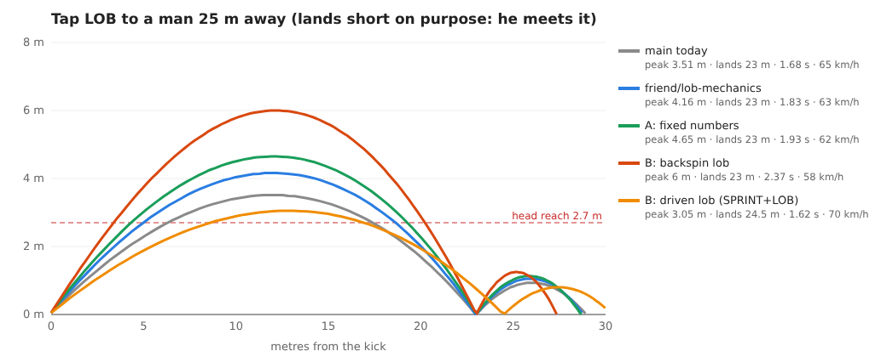
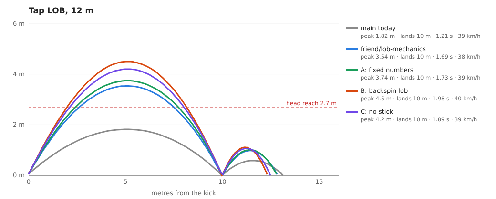
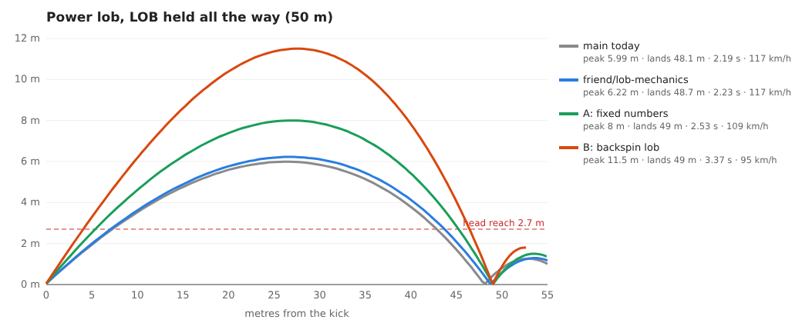
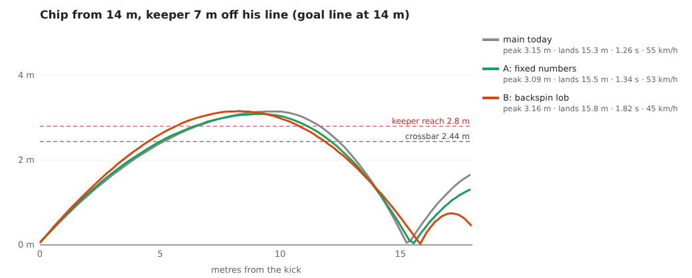
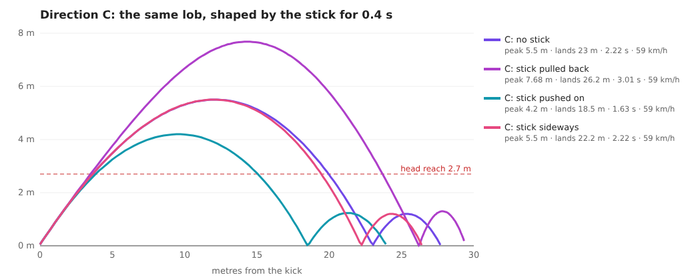
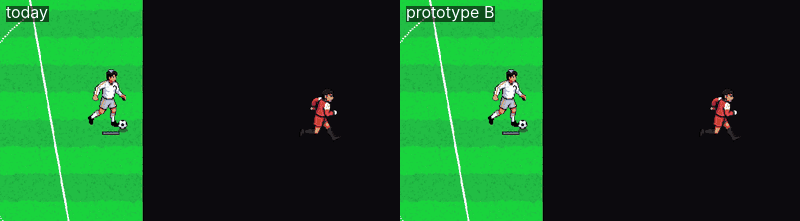

# Lob and chip revamp, stage 1: research, audit, three directions

Task t-002 (worker-f). Luca, 23 Oct 22:31: *"work on the game mechanics of the lob and chip in and of itself, revamp it
completely."* This stage changes nothing in a normal match. It gives the research, the measured audit, three
directions with a recommendation, and a test spec, so Luca can pick before the build starts.

Branch `worker-f/t-002-lob-chip`, built on the co-designer's `friend/lob-mechanics` (c0c0ca7 + merge), kept as is.

**Recommendation: direction B** (a real spin model with three lofted kicks), built in two steps: A's fixes and
readability first, then the spin. C's aftertouch can be added on top later, because it uses the same spin model.

**Try it:** serve the game (`cd game && python3 -m http.server 8765`), then open
`http://localhost:8765/index.html?lob=A` (or `?lob=B`, `?lob=C`). `labtest.html?lob=B` works in the Test Lab too.
Without `?lob=` the game is today's game.

---

## 1. Research

### Real ball flight
- **Forces.** In flight a football feels gravity, drag (against its motion) and Magnus lift (at right angles to its
  motion, set by its spin). Drag and lift both grow with ½ρAv² times a coefficient, and the coefficients depend on
  speed (Reynolds number) and on the spin ratio rω/v. [arXiv 1710.02784](https://arxiv.org/pdf/1710.02784),
  [Cross, Sports ball aerodynamics](https://www.physics.usyd.edu.au/~cross/TRAJECTORIES/Sports%20Balls.pdf)
- **Drag.** A modern ball's drag coefficient is about 0.12-0.15 above its "drag crisis" and about 0.2-0.25 or more
  below it. The crisis sits at Re ≈ 2.2-3.3 × 10⁵ (roughly 12-18 m/s, ball by ball): Asai & Seo 2013
  ([SpringerPlus](https://tsukuba.repo.nii.ac.jp/record/29043/files/SP_2-1.pdf)), and a 2026 study of four World
  Cup balls ([Sci. Rep.](https://link.springer.com/10.1038/s41598-026-56275-1)) found Cd ≈ 0.22 supercritical for
  the newest ball. Lobs and chips (10-20 m/s) fly right around the crisis. Physics Today puts it lower for a rough
  ball. [Physics Today, "Power and spin in the beautiful game"](https://physicstoday.aip.org/quick-study/power-and-spin-in-the-beautiful-game)
- **Lift from spin.** Goff & Carré measured soccer-ball lift coefficients from real trajectories for spin ratios
  0-1 (Re 1.3-3 × 10⁵), and later drag and lift curves from stereo high-speed video.
  [AJP 2009](https://wiki.penfieldrobotics.com/wiki/images/c/c0/Goff_Carre_AJP_2009.pdf),
  [Sheffield Hallam 2017](https://shura.shu.ac.uk/15728). The working rule is that the lift coefficient
  climbs with the spin ratio, about 0.2-0.3 at a spin ratio of 0.2-0.4.
- **Backspin makes a ball float, not dip.** The lift from backspin points up and back. It lengthens the climb and
  slows the fall. Topspin points it down, so the ball dips. [COMSOL, Magnus effect and the World Cup ball](https://www.comsol.com/blogs/magnus-effect-world-cup-match-ball/)
- **The chip.** A chip is a stab under the ball with little follow-through. The steeper the stab, the quicker it
  rises and the more backspin it gets ([Soccerhelp](https://soccerhelp.com/terms/soccer-chip.shtml),
  [Wikipedia](https://en.wikipedia.org/wiki/Chip_(association_football))). A worked example (12 m out, keeper 6 m
  off his line, 3 m clearance) comes out at about 10.8 m/s (39 km/h) at a 45° launch, leaving about 1.5 s before the defence can react. It
  needs a strike under about 20 m/s, so gravity beats drag and lift
  ([ShortList](https://www.shortlist.com/entertainment/sport/football-chip-messi-cantona-science-art/362180),
  [Chalkdust](https://chalkdustmagazine.com/blog/the-maths-behind-a-chip-goal/)). It works best when the keeper is
  off his line (Soccerhelp).
- **What our numbers should look like.** A 25 m lofted pass to a team-mate: about 15-18 m/s, 35-45°, a peak of 5-7 m,
  2-2.5 s in the air. A driven lob: faster and lower, 20-25°, a peak of 2.5-4 m. A chip from 12-16 m: about 40 km/h,
  40-50°, a peak of 3-5 m, 1.4-1.8 s.
  - The in-game drag is already right. `AIR_K = 0.012` per metre against ρ·Cd·A / 2m ≈ 0.011-0.013 for Cd
    0.2-0.25.
  - What's missing is spin, and the launch angles.

### How football games do it (in words only)
- **EA FC.** The chip shot is a shot, not a pass: a modifier plus SHOOT (L1/LB + Circle/B on pad, Left Shift + click
  on PC). The lob pass is its own button, held longer for more power. A driven lob / driven cross is that button
  plus a modifier, and a high lob is a second modifier. EA's line: the chip shot scores by beating a keeper who
  has come off his line; the lob pass finds a team-mate. [EA help: shooting](https://help.ea.com/en/articles/ea-sports-fc/how-to-shoot/),
  [EA help: passing](https://help.ea.com/da/articles/ea-sports-fc/how-to-pass/),
  [FC 25 controls](https://www.fifplay.com/fc-25-controls/), [FC 27 chip shot](https://www.fifplay.com/fc-27-chip-shot/)
- **PES / eFootball.** The chip is L1/LB held plus SHOOT. R1 is the controlled (placed) shot. The lofted pass / cross
  is its own button, with a separate high pass (RB + O). Power comes from how long you hold.
  [eFootball 2024 controls](https://www.fifplay.com/efootball-2024-controls/),
  [PES 2020 controls](https://realsport101.com/article/pes-2020-complete-controls-guide-goalkeeper-defence-attack-on-ps4-and-xbox-one),
  [pesmastery](https://pesmastery.com/?p=8302)
- **Sensible Soccer (and the arcade line before it).** One kick, shaped after it leaves the boot (**aftertouch**).
  - Keep pushing the same way: a low, hard ball. Let go: a lofted ball. Pull back: a long, high lob.
  - Sideways bends it, and how soon you push sets how much. A quick push forward after a loft dips it, which is one
    of the hardest skills in the game.
  - Aftertouch bend goes back to Tehkan World Cup (1985), and to Microprose Soccer's "banana kick" (1988).
  - [Giant Bomb](https://giantbomb.com/wiki/Games/Sensible_Soccer_European_Champions),
    [SWOS United hints](https://community.swosunited.com/forum/sensible-soccer-2006/1445-sensible-soccer-2006-hints-amp-tips)
- **How the player reads the arc.** Top-down and ¾ games all lean on the ground shadow. It stays under the ball
  and gets smaller or softer the higher the ball is, which is how you see where it will land.
  [player feedback, itch.io](https://itch.io/post/12812142). FC and PES add a landing marker on set pieces and on
  the lob's power bar.

### What makes it feel good
- Swink's *Game Feel*: real-time control (a response within ~100 ms), a simulated space, and polish that
  emphasises the interactions. [Wikipedia: Game feel](https://en.wikipedia.org/wiki/Game_feel),
  [review](https://lizengland.com/blog/review-game-feel-by-steve-swink/),
  [Designing Game Feel, a survey](https://arxiv.org/pdf/2011.09201)
- For a lob, that means:
  - **Readable arc:** the shadow shrinks as it climbs, plus a landing marker you can trust. The marker must use the
    real path, not a drawing of one.
  - **Anticipation:** the receiver and his marker start moving early. The duel at the drop is fair (the co-designer's
    `lobDuel` already does this).
  - **Timing:** a header / chest / volley window you can hit. 0.7 s now on the branch.
  - **Keeper reaction:** he reads the flight with a short, believable delay. Then he backpedals, tips it over, or is
    beaten.
  - **Sound and camera:** a softer "scoop" sound for a chip than for a strike, and a short slow-motion as it goes
    over him (already in, 0.55 s).
  - **Honest physics:** the same kick from the same place always does the same thing, so you can learn it.

---

## 2. Audit (measured on this branch: `friend/lob-mechanics` + nothing on by default)

### Where it lives
| What | Where |
| --- | --- |
| LOB tap / hold, the chip in their box | `actions.js:64-68` (`lobCharge` 0→1 over 0.9 s; under 0.2 = tap; `chipCan` → `chipShot`) |
| Lob flight | `ball.js` `releaseKick` (open-play `loft` lobs: `lobApex`; set pieces and throws: the old `T` formula) |
| Power lob, landing ring | `ball.js` `powerLob` / `lobSpot`; the ring and arc preview in `ui.js:425-431` |
| Chip | `ball.js` `chipCan` / `chipShot` / `chipSolve`; the dip in `ballStep` (`CHIP_DIP = 1.9` in `core.js`) |
| Chip slow-motion | `match.js:132-133` (0.55 s as it passes the keeper) |
| The drop: duel, headers | `actions.js` `lobDuel` / `headers` / `header` (the co-designer's) |
| Computer's lob choice | `teamai.js:358` (pass options: a lob when d > 14 m and its race risk + 0.25 wins), `:399` (carrier: lane > 1.5 and d > 15) |
| Computer's chip | `teamai.js:310-312`, knobs `chip` / `chipOff` in `difficulty.js:28` |
| Keeper | `keeper.js:144-147` BACK (a high ball dropping behind him), the CLAIM of crosses, the throw / punt (`mode: 'lob'`) |
| Shadow | `world.js:108` (`ball-shadow`: fixed size, alpha 1 → 0.35 by 3.9 m high) |

### The numbers (`ballStep` in the page; launch speed includes the climb)
| Kick | Launch | Peak | In the air | Above head height (2.7 m) | Falling at 2 m |
| --- | --- | --- | --- | --- | --- |
| Tap lob 12 m, `main` | 39 km/h, 35° | **1.8 m** | 1.21 s | 0 s | - |
| Tap lob 12 m, branch | 38 km/h, 53° | 3.5 m | 1.69 s | 0.82 s | 5.4 m/s |
| Tap lob 25 m, `main` | 65 km/h, 29° | 3.5 m | 1.68 s | 0.82 s | 5.3 m/s |
| Tap lob 25 m, branch | 63 km/h, 33° | **4.2 m** (meant: 4.65) | 1.83 s | 1.09 s | 6.3 m/s |
| Tap lob 40 m, branch | 97 km/h, 23° | **4.7 m** (meant: 5.7) | 1.95 s | - | - |
| Power lob, full hold, `main` | 117 km/h, 22° | 6.0 m | 2.19 s | 1.63 s | 8.2 m/s |
| Power lob, full hold, branch | 117 km/h, 23° | **6.2 m** (meant: 8.0) | 2.23 s | 1.69 s | 8.4 m/s |
| Chip 14 m, keeper on his line (tap) | 61 km/h, 25° | 2.4 m | 0.96 s to the line | - | - (crosses at 1.3 m, falling 7.7 m/s) |
| Chip 14 m, keeper 7 m out (tap) | 55 km/h, 32° | 3.2 m | 1.14 s to the line | - | **8 m/s** (crosses at 1.3 m, falling 10 m/s) |
| Chip 14 m, keeper 10 m out (hold) | 52 km/h, 49° | 5.7 m | 1.58 s to the line | - | crosses falling **14.6 m/s** |

Test Lab (headless, this branch):
- **CH:** CH1 GOAL (46 km/h, peak 3.1 m, 3.1 m over the keeper) · CH2 keeper saved it (on his line, as designed) ·
  CH3 GOAL · CH4 GOAL · CH5 a lob, not a chip (facing away, as designed) ·
  **CH6 "the computer chips a keeper who has come out" → it shot instead: 93 km/h, 0.4 m high** (a goal, so the test
  reads green) · `errors []`
- **KH:** 6 GOAL / 4 SAVED. KH9 "close range (6 m), chip over him" was caught · `errors []`
- **N5:** power lob held 15% / 55% / 100% → stopped 22.7 / 42.0 / 62.3 m away, top 3.9 / 5.2 / 6.2 m.
  N5-4 (you hold the LOB key) "not finished" · `errors []`
- `tools/lobstudy.js`:
  - you 60 trials: **75% kept**, ball lands 4.7 m from the aimed spot on average (on purpose: `d - 2`, he meets it)
  - computer v computer, 30 min: only **12 open-play lobs**, 42% kept (the co-designer measured 50% over a longer
    run: the sample is small)

### What's off
Against real life:
1. **The chip falls with almost 3 × gravity** (`CHIP_DIP = 1.9` adds 1.9 g on the way down). A real chip has backspin,
   which does the opposite: it floats. So today's chip is fast and flat (52-61 km/h against about 40 km/h for a real
   one), then drops like a stone: 10-15 m/s when it crosses the line. It looks "aggressive", as Luca asked in
   v0.9.2, but you can't read it, and a keeper can't either. The hold, which is meant to give more height for a
   keeper further out, mostly makes it fall faster.
2. **Lobs don't reach the height they're meant to.** `lobApex` sets the climb with √(2gh), which leaves drag out, so
   the branch's "3.6-6 m" lobs peak at 3.5-4.7 m and the "up to 8 m" power lob at 6.2 m.
3. **No spin anywhere.** Real lofted passes carry backspin: they climb longer, hang, then check on the bounce. Ours
   are drag-only parabolas, so every lofted ball has the same shape, from a 12 m dink to a 50 m switch.
4. **Long lobs are too flat and too fast.** A 40 m lob leaves at 97 km/h and 23°. Real long passes go higher and
   slower (35-45°).

Against the games:
5. **One button does three things by context.** LOB = a lob, LOB held = a power lob, and LOB in their box facing goal
   = a chip. FC and PES put the chip on a modifier + SHOOT, so a cross from the edge of the box never turns into a
   chip by accident (or the other way round: CH5).
6. **You can't see where it lands once it's gone.** The landing ring only shows while you charge a power lob. The
   arc drawn over the ring is a fixed sine (40-130 px), not the ball's real path. The shadow keeps one size, so
   height reads only from a faint alpha change.
7. **The keeper reads a lob instantly** (BACK starts the frame the ball is over 1.6 m) and has nothing to do about one:
   no backpedal, no tip over the bar. Against a chip he either catches it (on his line) or watches it go in.
8. **The computer barely lobs, and only judges risk.** 12 open-play lobs in 30 minutes. It never plays a power lob,
   a switch of play or a driven ball. Its chip (CH6) rarely fires: `Math.random() < 0.3-0.55 × K.chip`, and on
   Normal `chip` is about 0.15-0.6.

---

## 3. Three directions

All three keep the co-designer's work: `lobDuel`, nearest-first headers, the 0.7 s header window, the receiver
meeting it in the air, no block from behind. Set pieces and keeper throws keep their own flight unless noted. The
aerial specials start from any ball at volley / head height, so they keep working.

The prototypes (`?lob=A|B|C`) change only the flight of open-play lobs and the chip (`ball.js`, `core.js`, one line
in `actions.js`). The keeper, the AI and the readability items are described here, not built.

### A · Fix and polish (keep today's model)
- **Controls:** as today. Tap LOB = lob, hold = power lob, LOB in their box facing goal = chip.
- **Ball physics:**
  - the lobs really reach their height (`lobSolve`: solve for the measured peak, drag included)
  - a softer chip dip (`CHIP_DIP` 1.9 → 1.0); the chip solver stays
  - prototype: 25 m lob peaks at 4.65 m (meant 4.65); full power lob 8.0 m (meant 8.0)
- **Readability (in all three directions):**
  - the shadow scales from 100% to about 60% between 0 and 6 m (the existing sprite scaled, nothing drawn)
  - the landing ring stays on the grass until someone touches the ball, at the real predicted landing (`predict()`)
  - the charge arc follows the real path
- **Keeper:** BACK only after a read delay by level (0.15-0.35 s, as `gkReact`).
- **Computer:** as today, plus the power lob for switches over 30 m by level.
- **Passes / set pieces:** none.
- **New art:** none.
- **Size:** S, about 1 task.
- **Pros:** small, safe, quick to ship, and every number does what its comment says.
- **Cons:** it doesn't "revamp it completely". The chip is still a fake dip and every lofted ball has the same shape.

### B · Real spin, three lofted kicks (recommended)
- **Controls (like FC / PES):**
  - tap LOB = a high floated lob to a team-mate
  - hold LOB = power lob / switch
  - SPRINT + LOB = a **driven lob**: low, fast, onto his feet; it beats one man rather than everybody
  - the **chip** gets its own input, so it never fires by accident. Proposed: LOB + SHOOT together, or SHOOT
    while holding LOB, anywhere (it's only sensible near goal).
    - Keeping today's "LOB in the box facing goal" also works.
    - The prototype keeps today's chip input.
- **Ball physics:** backspin lift (Magnus) on every lofted ball, which decays in flight; backspin checks the ball on
  its first bounce.
  - Lob: about 30 rad/s, peak 4.5-9 m by distance (25 m: 6.0 m, 2.4 s, 1.8 s above head height).
  - Driven lob: about 8 rad/s, 2.4-3.8 m (25 m: 3.05 m, 1.6 s, 70 km/h).
  - Chip: a scoop with about 9 rev/s of backspin, about 45 km/h, falling 4 m/s at 2 m (today 8 m/s).
    - It floats over the keeper rather than dropping like a stone.
    - It is slower: 1.8 s against 1.3 s to land.
  - All of it from one formula (`MAGNUS_K = ρA/2m × r`), so it's consistent and learnable.
- **Computer by level:**
  - it picks floated / driven / chip from the lane, the receiver's marker and the keeper's position
  - Easy: mostly floated, mistimed
  - Normal: driven over one man, floated over a line
  - Hard / Rise: switches of play with the power lob, and chips only when the keeper is 4+ m off his line (the
    `chipOff` knob as today)
  - a trained knob per kick (how often, how accurate)
- **Keeper:**
  - reads the flight after a short delay by level, then backpedals (BACK)
  - a ball dropping under the bar within reach: he **tips it over** (a corner)
  - a floated chip gives him time, so a chip is a decision: float it high over a keeper far off his line, or don't
    chip
- **Passes / set pieces:** corners and free kicks get the spin too (in-swinging, floated, driven) as a later step.
- **New art (Luca's OK first):** keeper backpedal and tip-over-the-bar, E / NE / SE / S (W mirrored). About 2
  animations × 4 directions, roughly 8-16 PixelLab generations. The driven lob reuses the kick frames, and the
  chip keeps batch 15.
- **Size:** M-L, about 3 tasks:
  1. A's fixes plus readability
  2. the spin, the three kicks and the controls
  3. the keeper and the AI
- **Pros:**
  - real variety (three different shapes of ball)
  - readable and learnable, because the physics is honest
  - closest to what players know from FC / PES
  - the spin model also opens up curled crosses and free kicks later
- **Cons:**
  - the biggest change, and it needs AI re-tuning
  - the chip becomes slower and floatier than Luca's "faster, more aggressive" v0.9.2 chip (decision 2)
  - the prototype lobs, untuned, keep fewer: you 70% against 75% on the branch. The higher lobs fly longer, so
    defenders get there; the duel was tuned for the branch heights.

### C · Aftertouch (Sensible Soccer style, on B's spin)
- **Controls:** one lofted kick. Tap LOB = lob, hold = power. For 0.4 s after it leaves the boot the stick shapes it:
  - pull back = backspin: higher, floats, stops on the bounce (25 m lob: 7.7 m peak, lands 26 m)
  - push on = topspin: dips, runs on (4.2 m, lands 18.5 m)
  - sideways = curls that way (the prototype bends it 7 m by 26 m, too much: tune to about 3 m)
  - The chip is just a lob near goal with the stick pulled back, so no context switch.
- **Ball physics:** B's spin model; the player sets the spin.
- **Computer by level:** it "aftertouches" too (a knob per level): Easy never, Rise curls it away from the keeper or
  the defender.
- **Keeper / passes / set pieces:** as B. Corners and free kicks with aftertouch make a fun extra later.
- **New art:** as B (keeper backpedal, tip-over).
- **Size:** M, about 2-3 tasks (B's spin model plus the aftertouch input and the AI's use of it).
- **Pros:**
  - the most "16-bit": skill-based, unique among today's games
  - one button for everything, very expressive
- **Cons:**
  - a learning curve: it's easy to shape a lob by accident while you run, because the stick is also how you move
  - harder to read for the opponent
  - the AI needs its own timing
  - on a phone (paused) it would need a rethink

### Recommendation
**B, in steps.**
1. **A's fixes plus readability first.** A shrinking shadow, the landing ring that stays, and lobs that reach their
   height. It's small, it improves every direction, and Luca can feel it in a match within a day.
2. **Then the spin and the three kicks.** Floated, driven and chip, with the chip on its own input and the keeper's
   read and tip-over.
3. **C's aftertouch** can come later as an "advanced" option on top of B, because it's the same spin model.

---

## 4. Decisions for Luca
1. **Which direction:** A, B (recommended) or C?
2. **The chip's feel:**
   - **real** (B: a floated scoop with backspin, about 45 km/h, slower to land, the keeper has a chance)
   - **arcade** (today: fast, then a hard fake dip)
   - or a mix (B's float with a little extra dip)
3. **The chip's input:** keep "LOB in their box facing goal", or give it its own input (LOB + SHOOT)?
4. **The driven lob on SPRINT + LOB:** OK?
5. **New keeper animations** (backpedal, tip over the bar; about 8-16 PixelLab generations): OK to generate when the
   build starts?

## 5. Test spec (for the new Test Lab: the taskmaster adds these)
Each test sets up the ball at a player's feet with nobody near (unless said), plays the kick with the game's own
functions, and measures with the real `ballStep`. Pass marks are for the chosen direction (B shown).

| Id | Sets up | Measures | Passes when |
| --- | --- | --- | --- |
| LC1 | tap LOB to a team-mate 12 / 25 / 40 m away, nobody in between | peak, flight time, time above 2.7 m, where it lands v where he is | peak within 0.3 m of the design value; lands within 2.5 m of him; he controls it (feet / chest / header) |
| LC2 | power lob held 25 / 50 / 100% | distance, peak | distance 12 + 38 × hold ± 3 m; peak within 0.4 m of the design value |
| LC3 | driven lob 25 m, one defender halfway, 1 m off the line | peak over the defender, arrival speed | over him (> 2.7 m at his spot); arrives at the receiver under 1.5 m, at 8-14 m/s |
| LC4 | lob to a man with a defender 1 m goal-side of him (the duel) | who wins, 40 trials | the receiver wins 45-65% (a fair duel, not a sure thing either way) |
| LC5 | chip from 14 m, keeper 0 / 4 / 7 / 10 m off his line | height at the keeper, height at the line, time | keeper on his line: it's catchable (saved); 4+ m out: over his reach (> 2.8 m) and under the bar (< 2.3 m) at the line; GOAL at 7 and 10 m |
| LC6 | the computer on the ball 12 m out, keeper rushing to 7 m off, each level | does it chip, does it score, 20 trials per level | Easy chips < 20%, Rise > 50% when the keeper is 6+ m out, and Rise scores more than Easy |
| LC7 | a lob dropping behind a keeper 8 m off his line, toward goal | keeper reaction time, does he get back or tip it over | he starts back 0.15-0.35 s after the kick (by level); a ball under the bar within his reach is tipped or caught, never "walked in" |
| LC8 | shadow and landing ring on a 25 m lob | the ring's spot v the real landing; shadow scale at the peak | ring within 1 m of the real first bounce, the whole flight; shadow at 60-70% at 6 m |
| LC9 | the same 6 seeded matches with the new kicks off | scores, shots, possession | identical to `main` (the method used below) |

---

## 6. What's on the branch, and the checks
- `core.js`: `LOB_PROTO` (from `?lob=`; null = off), `MAGNUS_K`, `SPIN_TAU`, `CHIP_SPIN`.
- `ball.js`:
  - spin lift and curl in `ballStep`, and backspin checking the first bounce; all skipped when the ball has no spin
  - `lobSolve` (peak-true lobs)
  - `lobProto` / `aftOf` / `aftertouch` (the three directions)
  - the chip's spin in `chipSolve`
  - spin cleared when someone gains the ball, on a deflection, and on any other kick
- `actions.js`: one line, a header clears the spin.
- **Off = unchanged.** 6 seeded soak matches (`MATCHES=6 node tools/soak.js`) give the same scores, shots and
  possession on `friend/lob-mechanics` and on this branch: 3-1, 1-4, 1-0, 0-0, 0-1, 0-3.
- `node tools/smoke.js`: `{"easy":"1-1","normal":"0-1","hard":"0-0","rise":"0-0"}`, `errors []`.
- With each prototype on, `tools/lobstudy.js` runs without page errors. You keep 67% (A) / 70% (B) / 66% (C) of 47-51
  scripted lobs (branch: 75%). The computer's open-play lobs over 30 min are too few to compare (7-18).
